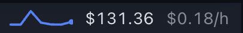

# Installing Hermetic

Hermetic has two halves, and both have to be on:

- **Agent**: the backend part. It records costs and routing, and serves the AAI and HDR data.
- **Desktop**: the button in the status bar and the popover it opens.

Hermes installs plugins switched off by default. The install command below turns on the Agent half, but the Desktop half stays off until you turn it on. That is why an agent can report "installed" while no button appears.

## Install

```bash
hermes plugins install forefy/hermetic --enable --force
```

Why `--force`: Hermes scans every plugin before installing it. Hermetic's HDR view watches sensitive places such as `~/.ssh`, cloud keys and startup folders, so its code names those paths, and the scan reads a list of them as a possible credential grab. That gives a "caution" verdict, which Hermes blocks for plugins from GitHub unless you pass `--force`. Hermetic never opens those files: it only checks whether a tool call touched them. The list is `_HDR_SENSITIVE` in `dashboard/plugin_api.py`, and you can read the scan yourself by running the command without `--force` first.

Then:

1. **Restart the Hermes desktop app**: Hermes menu, **Quit and Keep Windows**, then open Hermes again. This loads the backend and copies the Desktop half into the app. Until then the Plugins page shows the Desktop half as "copying…".
2. **Turn on the Desktop half**: open **Capabilities**, then **Plugins**, find **Hermetic**, and switch **Desktop** on. **Agent** is already on.
3. **Check the status bar**, bottom right.

## How you know it worked

A spend button appears in the status bar, bottom right: a small chart of recent spend, the total, and the current cost per hour.

<p align="center">
  
</p>

Click it. A popover opens with **Hermetic Costs** at the top; the arrow at the top right moves to **AAI** and **HDR**.

<p align="center">
  
</p>

## If something is missing

| What you see | Why | Fix |
|---|---|---|
| The install stops with "Blocked (community source + caution verdict)" | Hermes' install scan flags HDR's list of watched paths | Review the findings, then add `--force` as shown above |
| The agent says it is installed, but there is no button | The Desktop half is off | Capabilities, Plugins, Hermetic: switch **Desktop** on |
| The Plugins page shows "copying…" next to Desktop | Hermes has not restarted since the install | Quit and Keep Windows, then open Hermes |
| The button is there, but AAI or HDR asks you to restart | The backend is not loaded in this profile | Restart Hermes, and check that **Agent** is on for this profile |
| Provider routing, the policy bar or the OpenRouter account card are missing | Costs follows the profile of the chat you are in, and that profile does not use OpenRouter | Open a chat in an OpenRouter profile, or click the profile pill next to the total to see all profiles |

Hermetic turns itself on in your other Hermes profiles the first time the popover loads, so you install it once.

## Update

The bottom of the popover checks for a newer Hermetic once a day. When one is out, it says how many updates are available (hover for the list) and shows an **Update** button. Hermes' install scan checks every update and flags HDR's list of watched paths again; the popover then says so and offers **Install anyway**, which reinstalls from the same source with `--force`.

From a terminal, `hermes plugins update hermetic` stops at the same scan and has no override, so reinstall instead:

```bash
hermes plugins install forefy/hermetic --enable --force
```

Either way, restart Hermes afterwards as in step 1.

## Remove

```bash
hermes plugins remove hermetic
```

## Working on Hermetic itself

Clone the repo and link your Hermes install to the checkout, so Hermes loads your edits:

```bash
git clone https://github.com/forefy/hermetic.git
cd hermetic
./scripts/dev-link.sh
```
