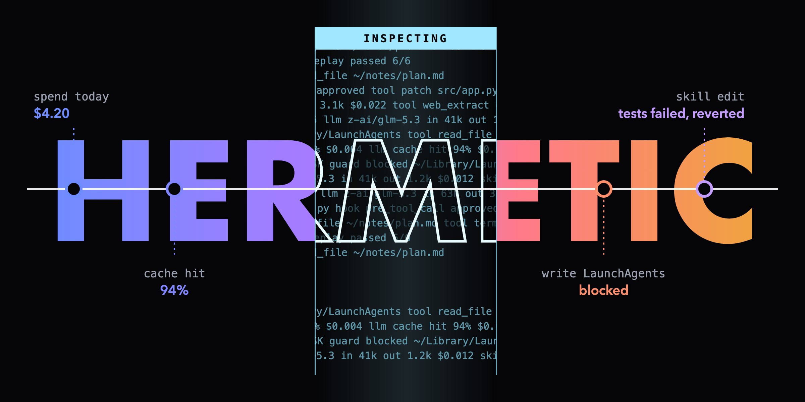

# Costs, quality and security for Hermes Desktop

<a href="https://hermes-agent.nousresearch.com/docs/plugins/hermetic" title="Hermetic in the Hermes plugin catalog">Install from Plugin Catalog</a>
| <a href="https://github.com/forefy/hermetic/issues/new" title="Report a bug">Report a bug</a>
| <a href="https://github.com/forefy/hermetic/issues/new?labels=enhancement" title="Request a feature">Feature request</a>
| <a href="https://twitter.com/forefy" title="Forefy on Twitter">Twitter</a>

https://github.com/user-attachments/assets/9edb1fa1-7460-437f-a577-f987e93c1042

## hermetic

hermetic is a hermes-agent desktop app plugin that shows what your agent costs, whether its skills and replies are getting better or worse, and what the harness itself is doing. Install it from [Here](https://hermes-agent.nousresearch.com/docs/plugins/hermetic).

- [hermetic Costs](#costs)
- [hermetic AAI (applied-AI quality)](#aai-applied-ai-quality)
- [hermetic HDR (harness detection and response)](#hdr-harness-detection-and-response)
- [What it does on your machine](#what-it-does-on-your-machine)

hermetic adds a tiny hermes status bar visual which covers all that was missing for me to be able to use it as a security researcher: deep costs tracking, evals and proofs for auto-improvements, and harness internals security.

  
  &nbsp;
  

## Costs

Deep and analytical cost tracking especially when using multi-provider routing (e.g. OpenRouter)

- Spend analytics per day, per session and live $/hour while turns run
- Cache hit rate: how much of each prompt came from the provider's cache, and what cache resets cost you.
- Pricing drift: what you were billed compared with list prices.
- OpenRouter spend limits with warnings when close to hit limits
- **Providers** (OpenRouter): which providers actually served your calls, where they are based, and your routing rules, with an extra verbose policy editor for them.
- **Improvement suggestions**: one-click config fixes, for example routing to the cheapest provider, running background tasks on a cheaper model, turning fallback on when calls fail on rate limits, or turning on Hermes' proactive prune of old tool output when, at the prices your chats were actually served, the re-sends it saves outweigh the full-price re-send each prune causes. Every fix shows the exact `config.yaml` change before it writes anything, and writes on top of the config as it is at that moment.

  
  &nbsp;
  

## AAI (applied-AI quality)

Evals, model-as-a-judge, and the missing layer for hermes auto-improve (randomly changing skills without proof they improved adds nothing)

- **Ratings**: rate replies 1 to 5 stars, the ones you pushed back on first ("no, …", "wtf, still broken"), and keep any of those as a test
- **Evals**: your saved tests replayed on your current routing, each coloured by its last result. From 5 tests on, compare your two most-used providers and a second model on the same tests
- **LLM as a judge**: grades replays with a rubric drafted from each skill. It has to earn trust against your ratings first (20 of them, 5 low) and fail most replies you corrected, and hermetic warns when it runs on your agent's own model family
- **Proof for auto-improve**: skill changes from the background review are tested automatically (off, ask me, or revert), and a change that tests worse can be reverted. An untrusted judge never decides a revert
- **Skill fixes**: for a skill whose tests fail, Hermes drafts a new version, it runs on the same tests, and you decide whether to ship it
- **Timeline and versions**: every skill change, routing change and rate-limit day, with changes that added links, code blocks or script files flagged, and every saved skill version to compare
- **Cleanup**: archive skills that were never used, saving tokens on every call

  

## HDR (harness detection and response)

Security monitoring for the harness itself: what it touched, where your data went and how exposed you are, with a guard that can ask you or block before the riskiest tool calls

- **Guard**: watch, ask or block the risky tool calls Hermes doesn't check itself (reading keys and logins, writing startup items and key places Hermes doesn't list), allowed or blocked once, per chat or always
- **Hooks**: every shell and gateway hook, what it can do, and what Hermes keeps quiet about: scripts edited after you approved them, new hooks, hooks running unasked under auto-accept
- **Where data went**: every host your agent reached, and the chats behind it
- **Files and secrets**: sensitive places tools touched, scored, with the line that ran and an expected list for jobs that read them on purpose
- **What runs on its own**: scheduled jobs, ports, subagents and background processes
- **What shapes every prompt**: SOUL.md and memory against Hermes' limits, and the writes chats made to them
- **Plugins and middleware**: where each plugin sits on model requests and tool calls, and what it registers without declaring

  
  &nbsp;
  

## What it does on your machine

### Model requests

When using a model provider (e.g. openrouter which this plugin supports best) hermetic adds an `llm_request` middleware that adds the routing fields from `provider_routing` in your `config.yaml` that Hermes does not send on its own:

- fallbacks
- zero data retention
- distillable text
- quantizations
- max price
- minimum throughput and maximum latency

The `llm_execution` middleware only reads the generation id and finish reason off the result.

### Tool calls

A `pre_tool_call` hook checks each tool call against HDR's rules (`hdr_rules.py`). hermetic HDR has these settings configurable:

- `Watch` (default) does nothing.
- `Ask` the call waits until 6 seconds before Hermes' hook limit (`plugins.hook_callback_timeout`, 24 seconds by default), while hermetic asks how to act (question waits at `~/.hermes/hermetic/hdr/asks/`) - no answer, or no popover checking in, blocks the call.
- `Block` stops the tool call. Rules you save are kept in each profile's `hermetic/hdr/guard.json`, and every decision is noted in `hermetic/hdr/guard.jsonl`. The guard never approves anything Hermes would ask about, and if its own check fails, the call goes ahead as if the guard were off.

### Plugin-initiated model calls

On AAI, only when you press replay, compare, draft or judge, or when you turn on automatic tests.
- Fix drafts, the judge and rubric drafts use Hermes' plugin model access (`ctx.llm`) on your main model. To let the judge use a different model, allow it in `config.yaml` under `plugins.entries.hermetic.llm` (`allow_model_override: true` and `allowed_models`).
- Replays call OpenRouter with the `OPENROUTER_API_KEY` Hermes holds for the profile, read through Hermes' secret scope. They follow your routing rules and appear in your spend like any other call. A replay costs about $0.01 per test; automatic tests stop at $0.50 a day.
- No API key ever reaches the popover - we're proud of this achievement as hermetic itself is a security-awareness tool, so we always try to act like one.

### Plugin-initiated network calls

Network calls are only done to supported providers (e.g. OpenRouter) to get latest price information, usage limits etc. no API keys sent through those calls, and only few requests a day are sent for different model informatics.

### Disk reads

We gave hermetic just enough power to provide extended security, while limiting anything that is not needed for these ops.

- Hermes' session database (read-only, through Hermes' `SessionDB`)
- `config.yaml`
- the skills and their change history
- scheduled jobs
- SOUL.md and the memory files (sizes and change times)
- installed plugin sources (to see what each registers)
- shell hooks in `config.yaml`
- Hermes' hook approvals (`shell-hooks-allowlist.json`), gateway hooks in `hooks/`, the hook scripts themselves (a copy of each, as first seen, is kept in `hermetic/hdr/hooks.json` to show later edits), and its own routing records.
- HDR runs `ps` and `lsof` locally to list ports opened under Hermes.

### Disk writes (only when you ask)

- Routing rules and the fixes you apply (through Hermes' own config functions, shown before writing)
- archived skills
- skill versions you ship or revert
- the guard's level and your guard rules
- places you mark as expected (`hermetic/hdr/expected.json`)
- test results.
- Everything Hermetic records stays in `$HERMES_HOME/hermetic/` (ratings, tests, replay results, saved skill versions, routing history).

### What can run in the background

- A thread checks every 5 minutes for skill changes made by the background review, and acts only if you turned automatic tests on. A short-lived thread stores the billed-spend snapshot.

### Plugin updates

Hermes auto-manages plugin updates for you after installation, from this repo we bump `version` in `plugin.yaml`, commit, then run `scripts/release.sh --pr`.

It runs the tests and Hermes' validation, pushes, fills the catalog entry with the new commit, and opens the pin-bump PR on NousResearch/hermes-agent. Catalog users get the update once a maintainer merges it.

Check the package with `hermes plugins validate .`
