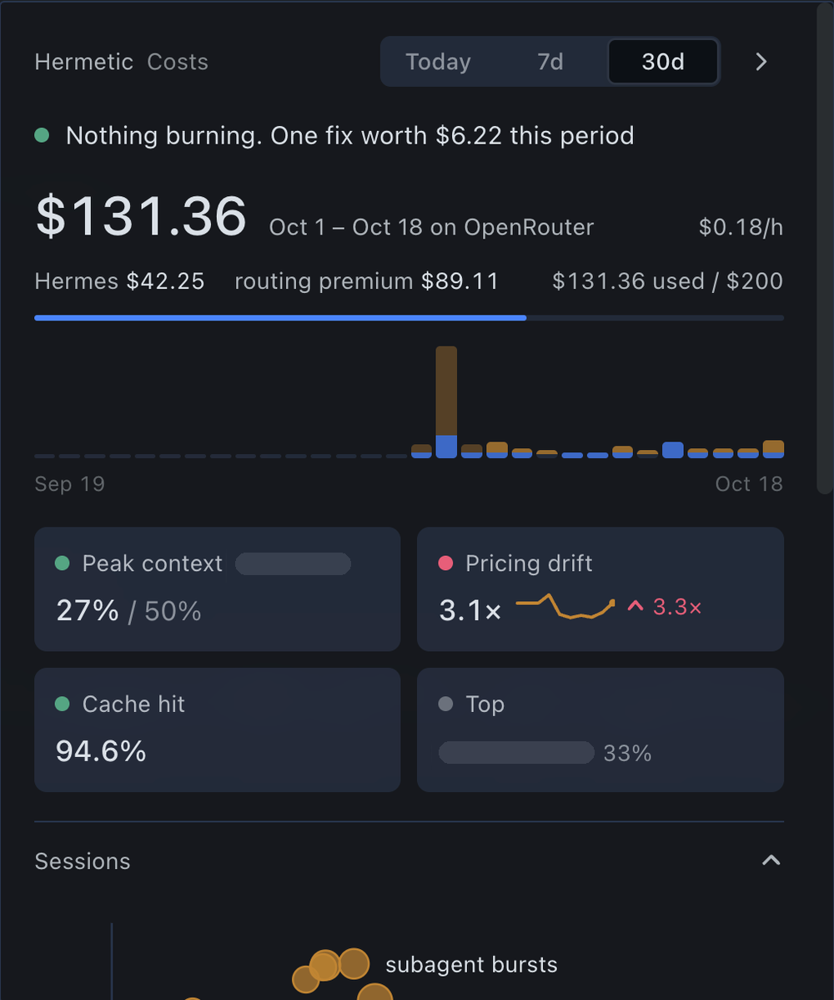
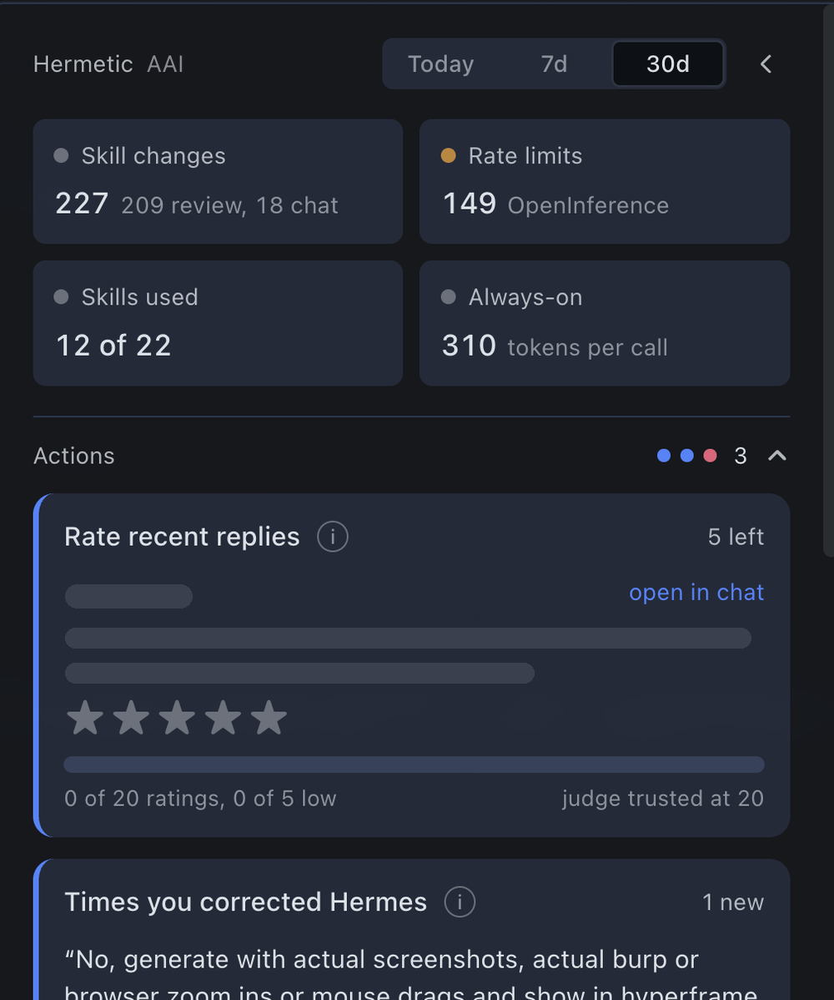
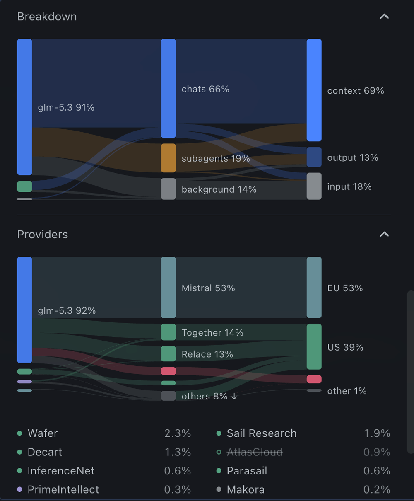
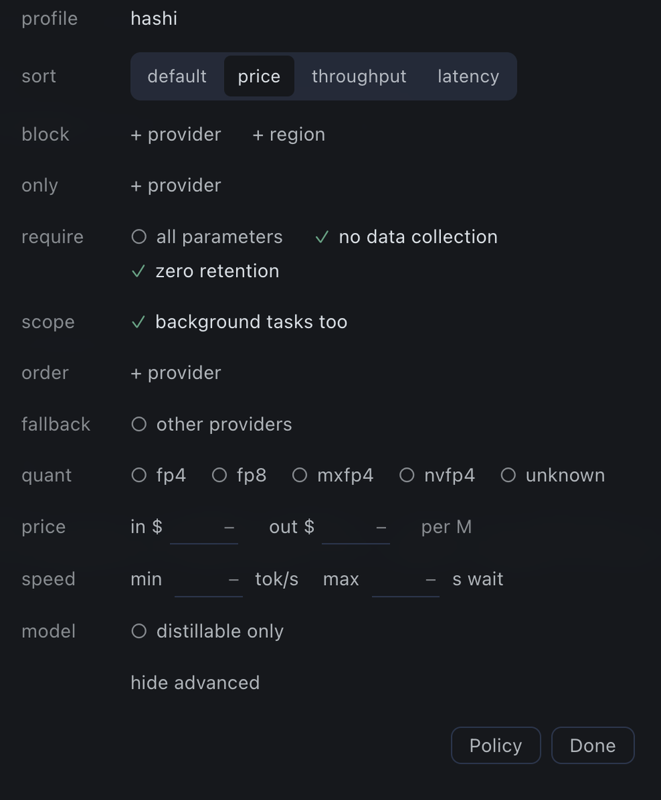
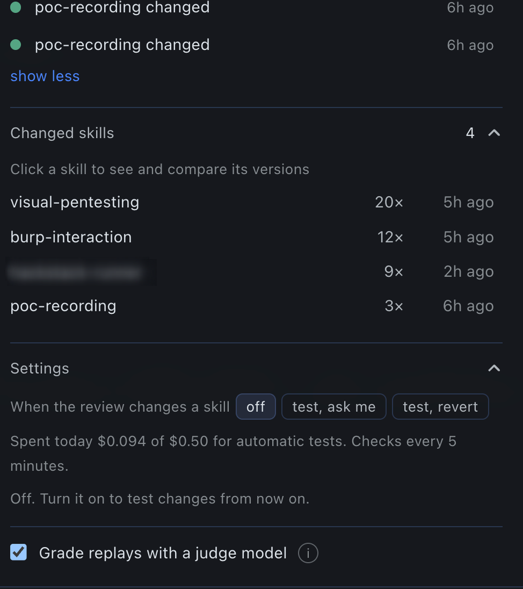
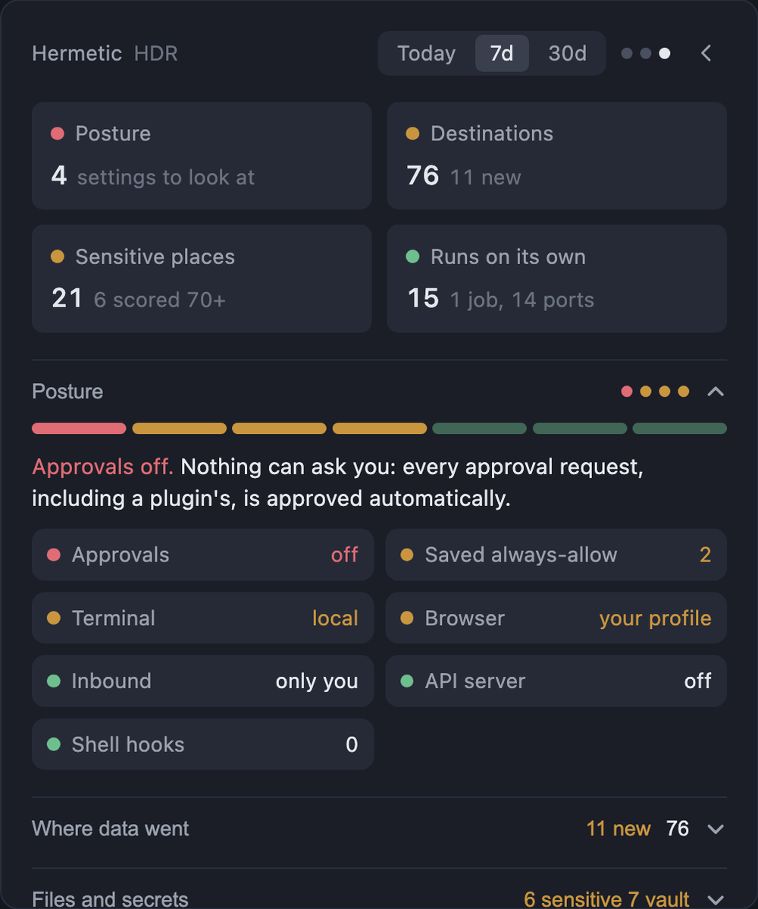
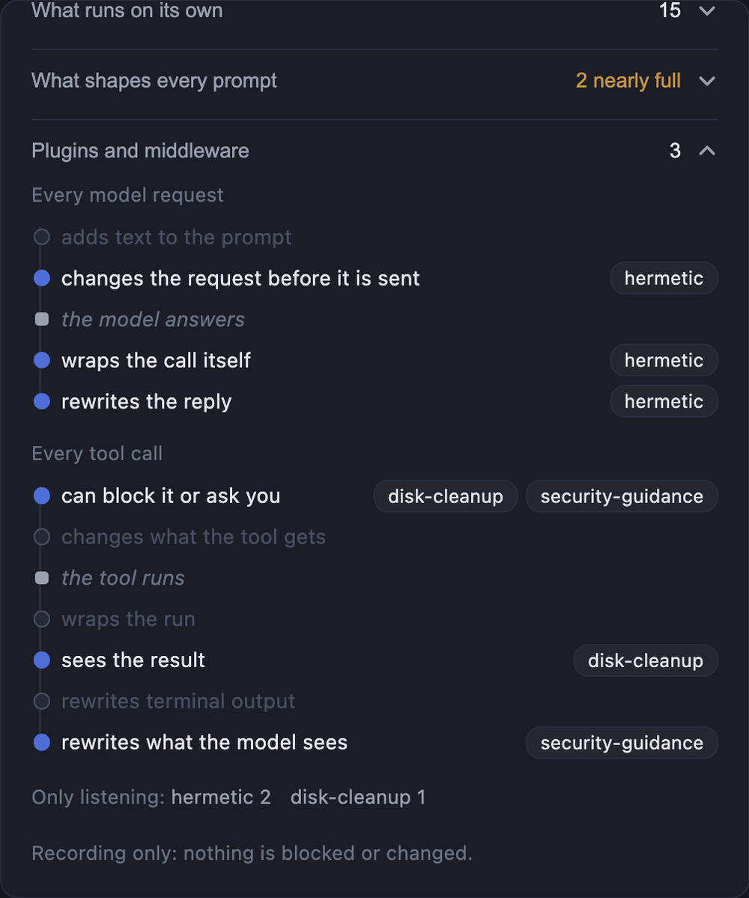

# hermetic

A status-bar popover for the [Hermes](https://github.com/NousResearch/hermes-agent) desktop app. It shows what your agent costs, whether its skills and replies are getting better or worse, and what the harness itself touched.

**Install:** `hermes plugins install hermetic --enable` from the Hermes plugin catalog once it is listed, or `hermes plugins install forefy/hermetic --enable --force` from GitHub. Then see [INSTALL.md](INSTALL.md) (two more steps, and how to check it worked).

It has three views in the same popover: Costs, AAI and HDR. The dots at the top right show which one you are on, and the arrow steps through them.

<p align="center">
  
  &nbsp;
  
</p>

## Costs

- Spend per day and per session, live $/hour while a turn runs, and the most expensive session.
- Cache hit rate: how much of each prompt came from the provider's cache, and what cache resets cost you.
- Pricing drift: what you were billed compared with list prices.
- **Providers** (OpenRouter): which providers actually served your calls, where they are based, and your routing rules, with an editor for them.
<p align="center">
  
  &nbsp;
  
</p>

- **Improve**: one-click config fixes, for example routing to the cheapest provider, running background tasks on a cheaper model, or turning fallback on when calls fail on rate limits. Every fix shows the exact `config.yaml` change before it writes anything, and writes on top of the config as it is at that moment.

## AAI (applied-AI quality)

- **Actions**: the few things that need you, each on its own card.
  - Rate recent replies with 1 to 5 stars.
  - Keep a time you corrected Hermes ("no, …", "you forgot …") as a test.
  - Fix a skill whose tests fail: Hermes drafts a new version, it is tested on the same tests, and you decide whether to ship it.
  - Revert a skill change that tested worse.
  - Archive skills that were never used, to save tokens on every call.
- **Tests**: every saved test as a tile, coloured by its last result. Replay them all with your current routing. From 5 tests on, compare your two most-used providers and a second model on the same tests.
- **Timeline**: skill changes made by chats and by the background review, routing changes, rate-limit days and Hermetic's own actions. Changes that added links, code blocks or script files are flagged.
- **Changed skills**: every saved version of a skill, and a replay to compare two of them.
- **Settings**: test skill changes automatically when the background review makes them (off, ask me, or revert), and grade replays with a judge model. Each skill's grading rubric is written from the skill itself the first time it is graded.

<p align="center">
  
</p>

Parts that only make sense with OpenRouter (provider routing, provider comparison, fallback) hide themselves when the profile does not use it. Spend, cache, sessions, ratings, corrections, the timeline and skill history work with any provider. Fix drafts and the judge go through Hermes' own model access for plugins, on your main model. Replays rerun a test on a chosen model and provider through OpenRouter, so they need an OpenRouter key set up in Hermes.

## HDR (harness detection and response)

What the harness touched and how exposed it is. It records and shows everything, and its guard can ask you or block before the riskiest tool calls.

<p align="center">
  
  &nbsp;
  
</p>

- **Guard**: one setting for the risky tool calls Hermes does not check itself: reading keys and logins (through any tool), and writing startup items or key places Hermes does not list (cloud keys, signing keys, GitHub and Docker logins, cluster access, the keychain, Hermes' vault). Writes Hermes already asks about, like shell settings and SSH keys, are left to Hermes. **Watch** records them. **Ask** holds the call and asks you in Hermetic, whatever Hermes' approvals setting: a card above the status bar (or a macOS notification when Hermes is in the background) says what the agent wants and why, and you allow or block it once, for that chat, or always, for the file, its folder or the whole kind. No answer in 20 seconds, or nobody at Hermes (scheduled jobs), blocks the call. **Block** stops the call and tells the agent why. Your saved rules are listed under the guard, each with a remove link.
- **Hooks**: every shell hook in `config.yaml` and every gateway hook in `hooks/`, what each can do (change tool calls, add to every prompt, see tool results, run with no prompt), whether Hermes approved it, and anything Hermes keeps quiet about: a hook script edited after you approved it (Hermes keeps trusting it; HDR shows the lines that changed until you mark it reviewed), new hooks, and hooks that run unasked because auto-accept is on.
- **Where data went**: every host that model requests and tools reached. Tool traffic is drawn as a flow from tool kind to destination to known or new, and each host lists the chats behind it.
- **Files and secrets**: where tools worked, and the sensitive places they touched (keys and logins, startup items, shell settings, system files, the browser vault), each scored. Reading keys scores high; writing to startup items scores highest.
- **What runs on its own**: scheduled jobs with their schedule and next run, ports opened under Hermes and the chats that opened them, subagents and background processes.
- **What shapes every prompt**: SOUL.md and the memory files against Hermes' own size limits, when each last changed, and memory and skill writes made from chats.
- **Plugins and middleware**: where each enabled plugin acts on the path of a model request and of a tool call, and anything it registers without declaring it.

Next: a low-cost judge that checks web pages and new skills before the model reads them.

## Install

```bash
hermes plugins install hermetic --enable
```

That is the catalog install, once Hermetic is listed. From GitHub, use `hermes plugins install forefy/hermetic --enable --force`: `--force` is needed there because Hermes' install scan flags the list of sensitive paths HDR watches, and [INSTALL.md](INSTALL.md) explains it. Then restart Hermes and switch on Hermetic's **Desktop** half under Capabilities, Plugins. Hermes installs it switched off, so this is the step that makes the button appear. [INSTALL.md](INSTALL.md) has the steps, what you should see when it worked, and fixes for what can go wrong.

Hermetic does not update itself. Catalog installs update from the Hermes Plugins page or with `hermes plugins update hermetic`; GitHub installs update by running the install command again.

## What it does on your machine

**Model requests.** On every request that goes to OpenRouter, Hermetic's `llm_request` middleware adds the routing fields from `provider_routing` in your `config.yaml` that Hermes does not send on its own: fallbacks, zero data retention, distillable text, quantizations, max price, minimum throughput and maximum latency, including per-model overrides. Requests to any other provider go out unchanged, and on any error the request goes out unchanged. The `llm_execution` middleware only reads the generation id and finish reason off the result.

**Tool calls.** A `pre_tool_call` hook checks each tool call against HDR's rules (`hdr_rules.py`). At Watch, the default, it changes nothing. At Ask the call waits, up to 20 seconds, while Hermetic asks you: the question sits in `~/.hermes/hermetic/hdr/asks/` (shared by every profile), the popover lists it every 2 seconds and shows it, and a macOS notification asks when Hermes is in the background; no answer, or no popover checking in, blocks the call. At Block it stops them. Rules you save are kept in each profile's `hermetic/hdr/guard.json`, and every decision is noted in `hermetic/hdr/guard.jsonl`. The guard never approves anything Hermes would ask about, and if its own check fails, the call goes ahead as if the guard were off.

**Model calls of its own.** Only when you press replay, compare, draft or judge, or when you turn on automatic tests.
- Fix drafts, the judge and rubric drafts use Hermes' plugin model access (`ctx.llm`) on your main model. To let the judge use a different model, allow it in `config.yaml` under `plugins.entries.hermetic.llm` (`allow_model_override: true` and `allowed_models`).
- Replays call OpenRouter with the `OPENROUTER_API_KEY` Hermes holds for the profile, read through Hermes' secret scope. They follow your routing rules and appear in your spend like any other call. A replay costs about $0.01 per test; automatic tests stop at $0.50 a day.
- No API key ever reaches the popover.

**Network.** The popover reads OpenRouter's public model, provider and zero-retention lists. The backend asks Hermes for your OpenRouter account usage (at most every few minutes, OpenRouter profiles only) to show billed spend. Nothing else leaves your machine.

**What it reads.** Hermes' session database (read-only, through Hermes' `SessionDB`), `config.yaml`, the skills and their change history, scheduled jobs, SOUL.md and the memory files (sizes and change times), installed plugin sources (to see what each registers), shell hooks in `config.yaml`, Hermes' hook approvals (`shell-hooks-allowlist.json`), gateway hooks in `hooks/`, the hook scripts themselves (a copy of each, as first seen, is kept in `hermetic/hdr/hooks.json` to show later edits), and its own routing records. HDR runs `ps` and `lsof` locally to list ports opened under Hermes.

**What it writes, and only when you ask.** Routing rules and the fixes you apply (through Hermes' own config functions, shown before writing), archived skills, skill versions you ship or revert, the guard's level and your guard rules, and test results.

**In the background.** A thread checks every 5 minutes for skill changes made by the background review, and acts only if you turned automatic tests on. A short-lived thread stores the billed-spend snapshot.

Everything Hermetic records stays in `$HERMES_HOME/hermetic/` (ratings, tests, replay results, saved skill versions, routing history).

## Layout

| Path | What it is |
|---|---|
| `desktop/plugin.js` | The popover: plain ESM for the Hermes plugin SDK, no build step |
| `__init__.py` | Hooks and middleware: per-call cost and routing records, provider errors, empty-reply debugging |
| `dashboard/plugin_api.py` | Backend routes under `/api/plugins/hermetic/` |
| `hdr_rules.py` | What a tool call touches and how risky it is; shared by HDR and the guard |
| `plugin.yaml` | Package manifest |
| `tests/test_hdr.py` | HDR detection rules |
| `tests/test_guard.py` | The guard: what it asks about, blocks and lets through |
| `tests/test_hooks.py` | Hooks monitoring, and the routes behind the guard's own Ask |
| `tests/test_credentials.py` | Hermetic's own model calls go through Hermes (`ctx.llm`, secret scope) |
| `tests/test_paths.py` | Skill names and version ids from requests never leave Hermetic's folders |
| `tests/test_session_cache.py` | HDR and AAI re-read only the sessions that changed |
| `tests/test_usage_days.py` | A chat's cost spread over the days it ran, not just the day it started |
| `tests/test_config_routes.py` | Config writes reach only the profile Hermes scoped the request to |
| `tests/test_limits.mjs` | Which OpenRouter limit stops requests first, credits or the key's cap |
| `tests/test_share.mjs` | One profile's part of an OpenRouter bill shared with other profiles |
| `tests/test_prices.mjs` | A provider's model id matched to its OpenRouter list price |
| `tests/test_detect.mjs` | How a profile's provider is read from its config |
| `scripts/release.sh` | Tests, validates and pushes a release, then prints the catalog entry; `--pr` opens the catalog PR |
| `catalog/hermetic.yaml.in` | Template for the catalog entry |

Run the Python tests inside Hermes' environment, and the rest with node:

```bash
bash ~/.hermes/hermes-agent/scripts/run-in-hermes-env python3 tests/test_hdr.py
node tests/test_detect.mjs
node tests/test_limits.mjs
```

Check the package with `hermes plugins validate .`

## Releasing

Bump `version` in `plugin.yaml`, commit, then run `scripts/release.sh --pr`. It runs the tests and Hermes' validation, pushes, fills the catalog entry with the new commit, and opens the pin-bump PR on NousResearch/hermes-agent from your fork, asking before it pushes and before it opens the PR. Catalog users get the update once a maintainer merges it.
